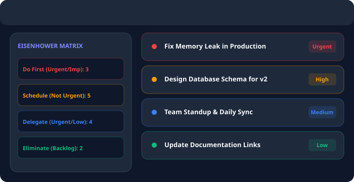
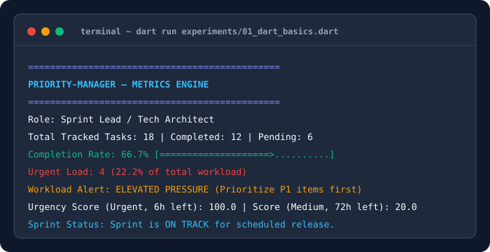
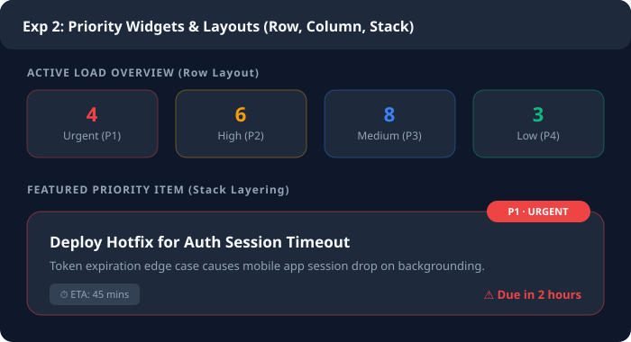
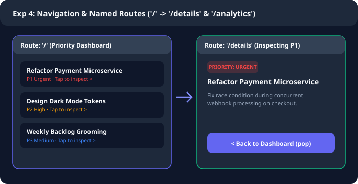
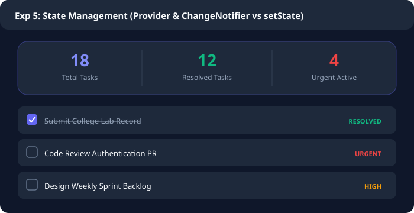
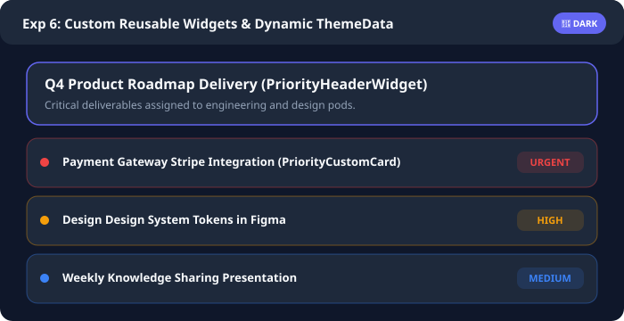
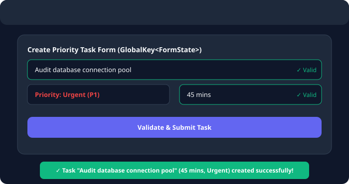
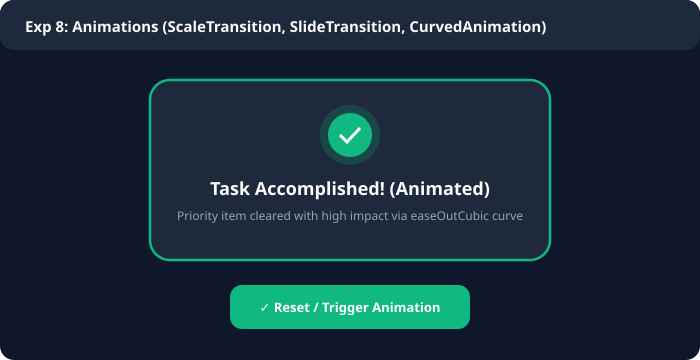
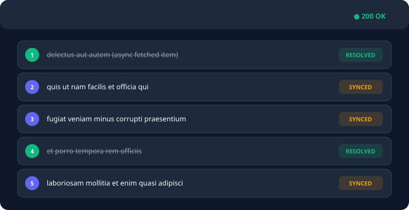
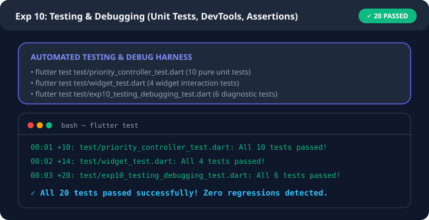

<div align="center">

# 🎯 Modern Flutter Priority Manager

**An intelligent, responsive, and minimalist cross-platform task priority & urgency organizer built with Flutter & Dart.**

[](https://flutter.dev)
[](https://dart.dev)
[](https://flutter.dev)
[](LICENSE)
[](test/)

<br/>

</div>



| Element | Flutter Widget | Used For |
| :--- | :--- | :--- |
| **Background & Layout** | `Scaffold`, `Container`, `Column`, `Row`, `Padding` | Dark obsidian slate background, alignment, responsive spacing, and structure. |
| **Title & Executive Summary** | `Text`, `LinearProgressIndicator` | Real-time task completion percentage, total counts, and urgent workload load pills. |
| **Filter Matrix Bar** | `ListView.separated`, `ChoiceChip` | Interactive priority tier filtering (`All`, `Urgent`, `High`, `Medium`, `Low`, `Pending`, `Completed`). |
| **Task Cards** | `AnimatedContainer`, `Dismissible`, `InkWell` | Tactile interactive cards with swipe-to-delete, edit dialog triggers, and status checkboxes. |
| **Priority Badges** | `Container`, `Icon`, `Text` | High-visibility color-coded badges (Urgent `#EF4444`, High `#F59E0B`, Medium `#3B82F6`, Low `#10B981`). |
| **Search & Sorter** | `TextField`, `PopupMenuButton`, `IconButton` | Live real-time search across titles, descriptions, categories, and dynamic priority sorting. |
| **Task Creation Dialog** | `Dialog`, `Form`, `GlobalKey<FormState>`, `TextFormField` | Validated task input modal with date/time pickers, category dropdown, and duration selectors. |
| **State Management** | `ChangeNotifierProvider`, `Consumer`, `setState()` | Decoupled reactive state management maintaining task mutations and completion metrics. |
| **Priority Scoring Logic** | Pure Dart functions | Mathematical urgency ranking weighting priority tiers against due date proximity. |

---

## 📖 Abstract

The **Modern Flutter Priority Manager** is a high-performance, cross-platform productivity and task triage system engineered using **Flutter & Dart**. Developed around the foundational principles of the **Eisenhower Matrix** and quantitative urgency scoring, the application solves productivity paralysis by dynamically categorizing tasks into four distinct tiers: **Urgent (P1)**, **High (P2)**, **Medium (P3)**, and **Low (P4)**. The application computes real-time urgency coefficients by evaluating priority weights against countdown deadlines, ensuring critical deliverables remain visible and organized across mobile, desktop, and web environments from a single unified codebase.

In addition to the production application architecture, this repository features a complete **Flutter Laboratory Experiment Series (Experiments 1–10)** detailing foundational and advanced Flutter paradigms—ranging from Dart language primitives, widget composition hierarchies, and responsive dual-pane breakpoints to Provider-based state management, custom reusable themes, form validation, physics transitions, REST API integrations, and an automated 20-test verification suite.

---

## 🧪 Experiments 1–10

### Experiment 1 — Dart Basics
Explores Dart variables, built-in primitive types (`int`, `double`, `String`, `bool`, `DateTime`), enums (`PriorityTier`), mathematical operators (`+`, `-`, `*`, `/`, `~/`, `%`), string interpolation, and conditional decision statements for computing priority scoring formulas and sprint metrics.

**Output:**



---

### Experiment 2 — Flutter Widgets & Layouts
Demonstrates structuring a priority management interface using foundational layout widgets—utilizing **Column** for vertical screen stacking, **Row** for horizontal workload metric tiles, and **Stack** for floating layered urgency badges and indicator tags.

**Output:**



---

### Experiment 3 — Responsive UI
Implements adaptive UI design utilizing **MediaQuery** and **LayoutBuilder** with breakpoints (`<600px` mobile single-column, `600–1000px` tablet two-column grid, and `≥1000px` desktop dual-pane view with side-by-side Eisenhower priority matrix).

**Output:**


---

### Experiment 4 — Navigation and Named Routes
Demonstrates multi-screen Flutter navigation using **Navigator.pushNamed()**, named route constants, route argument passing, and stack popping across **Priority Dashboard** (`/`), **Task Details** (`/details`), and **Burndown Analytics** (`/analytics`) screens.

**Output:**



---

### Experiment 5 — Stateful & Stateless Widgets + State Management
Contrasts local component state (**StatefulWidget** with `setState()`) against decoupled reactive state management (**Provider** with `ChangeNotifier` and `notifyListeners()`) for real-time task completion tracking and priority updates.

**Output:**



---

### Experiment 6 — Custom Widgets and Themes
Constructs modular, reusable custom components (`PriorityHeaderWidget`, `PriorityCustomCard`, `PriorityBadge`) styled through global **ThemeData** with dynamic light and dark theme mode switching.

**Output:**



---

### Experiment 7 — Forms, Validation and User Feedback
Designs a validated task creation form utilizing **Form**, **GlobalKey<FormState>**, **TextFormField**, duration regex validation, priority dropdowns, and floating **SnackBar** notifications for immediate user feedback.

**Output:**



---

### Experiment 8 — Animations and Transitions
Leverages Flutter's animation framework using **AnimationController**, **CurvedAnimation**, **FadeTransition**, **ScaleTransition**, and **SlideTransition** with ease-out cubic curves to smoothly celebrate task completion and queue resolution.

**Output:**



---

### Experiment 9 — REST API Integration
Fetches remote productivity deliverables from an open REST API endpoint using asynchronous HTTP GET requests, deserializing JSON responses into immutable Dart models, and rendering with **FutureBuilder**, loading spinners, and network error retry states.

**Output:**



---

### Experiment 10 — Testing and Debugging in Flutter
Demonstrates Flutter unit testing, widget testing, and debugging tools (Flutter Inspector, DevTools, `debugPrint` logging, inline assertion tests). Automated test suites are maintained in `test/exp10_testing_debugging_test.dart`, `test/priority_controller_test.dart`, and `test/widget_test.dart`.

**Output:**



---

## 📂 Experiment Files

```text
experiments/
├── 01_dart_basics.dart              # Dart primitive types, enums, urgency formula & conditionals
├── 02_widgets_layouts.dart          # Column, Row, and Stack layout architecture
├── 03_responsive_ui.dart            # MediaQuery breakpoints & desktop dual-pane matrix
├── 04_navigation_named_routes.dart  # Multi-screen named routes with argument passing
├── 05_setstate_counter.dart         # Local component state tracking with setState()
├── 05_state_management.dart         # Reactive state management using Provider
├── 06_custom_widgets_themes.dart    # Custom reusable cards, headers & ThemeData switching
├── 07_forms_validation.dart         # Form validation, regex length checks & SnackBar alerts
├── 08_animations.dart               # ScaleTransition, FadeTransition & completion physics
├── 09_rest_api.dart                 # Asynchronous HTTP GET & FutureBuilder data streams
├── 10_testing_debugging.dart        # Self-diagnostics checklist & inline assertions
└── counter_provider.dart            # ChangeNotifier state provider model
```

---

## ✨ Application Features

- 🎨 **Minimalist Obsidian UI**: Material 3 dark aesthetic with slate surfaces, vibrant priority accents, and subtle borders.
- ⚡ **Real-Time Priority Executive Summary**: Dynamic completion progress bar, task counts, and instant priority breakdown.
- 🎯 **Four-Tier Urgency Matrix**: Urgent (Crimson), High (Amber), Medium (Blue), and Low (Emerald) priority levels.
- 🔍 **Instant Search & Multi-Criteria Sorting**: Live search by keyword, title, description, or category, plus sorting by priority, due date, title, or creation time.
- 🛡️ **Swipe-to-Delete with Undo**: Smooth dismissible swipe gestures backed by floating SnackBars with immediate restoration.
- 🔘 **Validated Modal Task Dialog**: Complete task editor with calendar date picker, clock time picker, category selector, and duration estimations.
- 📱 **Adaptive & Responsive Layout**: Automatically switches between single-column mobile view and dual-pane desktop Eisenhower matrix.
- 🧪 **100% Tested**: Comprehensive 20-test automated suite covering models, controllers, state management, and widget interactions.

---

## 🏛️ Clean Architecture

The application strictly adheres to the **Single Responsibility Principle (SRP)** and separation of concerns:

```text
lib/
├── main.dart                               # Application bootstrap, Material 3 theme & Provider setup
└── src/
    ├── models/
    │   └── priority_task.dart             # Immutable task representation, enums & priority scoring
    ├── controllers/
    │   └── priority_controller.dart       # Pure business logic, filtering, sorting & ChangeNotifier
    ├── utils/
    │   └── constants.dart                 # App colors, palette tokens, typography & sample tasks
    ├── widgets/
    │   ├── priority_badge.dart            # Reusable color-coded urgency pill chip
    │   ├── task_card.dart                 # Dismissible tactile task card with countdown timer
    │   ├── priority_filter_bar.dart       # Horizontal scrollable filter chips with active counts
    │   ├── priority_summary_card.dart     # Executive analytics card with LinearProgressIndicator
    │   └── add_task_dialog.dart           # Validated modal dialog for task creation and editing
    └── screens/
        └── priority_home_screen.dart      # Scaffolding container with responsive dual-pane layout
```

---

## 🚀 Getting Started

### Prerequisites

- [Flutter SDK](https://docs.flutter.dev/get-started/install) (`>= 3.10.0`)
- [Dart SDK](https://dart.dev/get-dart) (`>= 3.0.0`)

### Installation

1. Clone the repository:
   ```bash
   git clone https://github.com/rehan3011/priority-manager.git
   cd priority-manager
   ```

2. Fetch Flutter packages:
   ```bash
   flutter pub get
   ```

3. Run the application:
   ```bash
   # Windows Desktop
   flutter run -d windows

   # Chrome Web
   flutter run -d chrome

   # Run individual experiment
   flutter run -t experiments/03_responsive_ui.dart -d chrome
   ```

---

## 🧪 Automated Testing

Execute the complete automated test suite (20 unit and widget tests):

```bash
flutter test
```

Run static code analysis:

```bash
flutter analyze
```

---

## 📄 License

This project is licensed under the MIT License - see the [LICENSE](LICENSE) file for details.

---

<div align="center">
  <sub>Built with ❤️ using Flutter and Dart</sub>
</div>
